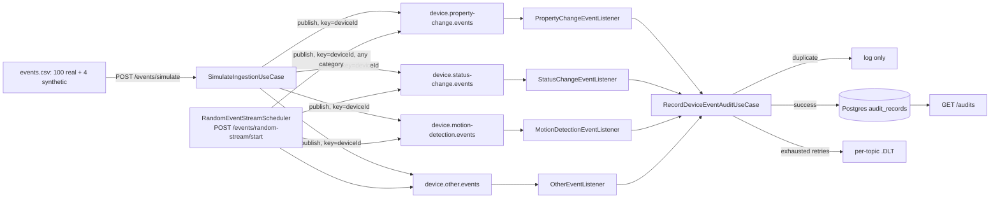

# Architecture

## Diagram

## Classification: EventCategory from msgType

The real dataset has no device-type column. Its `msgType` field (always present) is
grouped into the four kinds of event the case brief itself names: `PROPERTY_CHANGE`
(`iotProperty`), `STATUS_CHANGE` (`online`/`offline`), `MOTION_DETECTION`
(`videoMotion`/`mobileDetect`/`human`/`smartVideoMotion`), `OTHER` (everything else,
including any future unrecognized `msgType`).

## Load generation: random event stream

Beyond the one-shot CSV replay, `POST /events/random-stream/start` runs a background
`RandomEventStreamScheduler` that fabricates and publishes synthetic events at a
caller-chosen rate (events/minute), with no upper cap. It reuses the exact
publish → consume → audit path unchanged — same topics, same listeners, same
`EventPublisherPort` — nothing on the consumer side knows the difference between a
CSV-sourced event and a generated one. Generated devices are prefixed `RANDOM-` so
they're distinguishable in `/audits` and Grafana from the CSV demo's `DEVICE-...`/
`SYNTHETIC-DLQ-...` rows.

Its purpose is deliberately adversarial to the consumer side: push past
`audit-service`'s current capacity, watch Kafka consumer lag grow on the existing
Grafana dashboard and the `AuditConsumerLagHigh` alert, then demonstrate that scaling
the consumer (listener concurrency, partition count, more app instances) makes that
lag recover. `dlqRate`/`duplicateRate` (0–1, independently rolled per generated event)
let the same demo also exercise the retry/DLQ path and the dedup path on demand,
instead of relying only on the CSV's 4 fixed synthetic rows. Full design rationale in
`docs/superpowers/specs/2026-10-11-random-event-stream-design.md`.

## Scalability and Kafka partitioning strategy

Each category gets its own topic, partitioned by `deviceId`, 3 partitions at case
scale. At millions-of-events/day scale, partition count would grow per topic based on
observed throughput and target consumer parallelism; `PROPERTY_CHANGE` (45% of this
sample) would likely need more partitions than `OTHER` (10%).

**Sizing math.** "Millions of events/day" divided across 86,400 seconds/day is deceptively
modest on average — 1,000,000/day ≈ 11.6 events/sec, 5,000,000/day ≈ 58 events/sec — but
IoT traffic is bursty (mass firmware rollouts, outage recovery floods), so design for
peaks 5–10× the daily average, not the average itself. Partition count is the hard
ceiling on consumer parallelism per topic, and increasing it later (recreating the topic
is the only way to decrease it) means re-keying and a rebalance, so it's provisioned
generously up front rather than reactively. Mapping that to partitions: at 5M/day peak
(290–580 ev/sec total), `PROPERTY_CHANGE`'s ~45% share is ~130–260 ev/sec; at roughly
50–100 ev/sec per consumer thread (one DB round trip per event, see Idempotency below),
that needs only 2–6 threads to keep up — but partitions would still be provisioned well
above that bare minimum (e.g. 8–16 for the hottest topic) to leave headroom for threads
tied up retrying/dead-lettering and for future growth.

**Producer durability.** Today, `application.yml` sets no producer tuning at all — acks,
idempotence, batching, and compression all run on whatever Spring Boot and kafka-clients
default to, not on an explicit decision. In production these would be pinned explicitly:
`acks=all` and `enable.idempotence=true` (producer-side exactly-once-per-partition,
pairing with the existing `eventId` dedup for an end-to-end exactly-once effect),
`linger.ms`/`batch.size` tuned for throughput over per-message latency, and
`compression.type=lz4` (or `zstd`) to cut network and broker-disk cost at this volume.

**Replication.** `KafkaTopicConfig` hardcodes `replicas(1)` for every topic today — correct
for this case's single local KRaft broker, but a single point of failure. Production would
run replication factor 3 with `min.insync.replicas=2`, brokers spread across multiple
availability zones, so losing a broker (or a whole AZ) doesn't lose acknowledged writes or
stall producers.

**Hot partitions.** Keying by `deviceId` keeps one device's events in order on one
partition, but a single very chatty device concentrates all of its own traffic on that
one partition, capping its throughput at one consumer thread and potentially skewing load
across the partition set. The usual mitigation — splitting a hot key across several
partitions via a composite key or salting — trades away exactly the per-device ordering
guarantee this design relies on, so it's a call made per hot device, not a default.

## Consumer groups and parallelism

All four listeners share consumer group `audit-service` — one logical consuming
application across four topics. Concurrency (3, matching partition count) parallelizes
within each topic. Scaling horizontally means more `audit-service` instances, up to the
partition-count ceiling per topic.

**Consumer scaling at production volume.** Beyond the per-topic partition-count ceiling,
extra `audit-service` instances sit idle — Kafka never assigns more than one consumer per
partition within a group. Rebalancing on instance join/leave briefly pauses affected
partitions; the cooperative-sticky assignor (vs. the default eager range assignor)
minimizes that pause by reassigning only the partitions that actually need to move.
Autoscaling instance count directly off consumer lag (e.g. KEDA's Kafka scaler) turns
"add capacity when lag grows" into an automated response instead of a manual one.

## Ordering

Keying every record by `deviceId` guarantees one device's events land on the same
partition, consumed in order, by one consumer thread at a time. Different devices may
interleave, by design, for parallelism.

## Idempotency and duplicate handling

`eventId` is resolved once, in `device.core`: the dataset's own native id
(`body_completo.id`, present on camera/alarm-style events, or `body_completo.alarmId`
for `iotEvent`) when available, else a deterministic SHA-256 hash of
`deviceId|eventType|timestamp|payload`. `audit` checks `existsByDedupKey(eventId)`
before processing; a duplicate is logged and skipped. A database-level unique
constraint on `event_id` backs this up against race conditions.

**Idempotency at scale.** The check-then-insert pattern above is one extra DB round trip
per event on top of the insert itself — fine at case scale, a real cost at millions/day.
The usual production fix drops the separate `existsByDedupKey` read entirely and relies
on the unique constraint with an upsert (`INSERT ... ON CONFLICT DO NOTHING`), turning two
round trips into one and letting Postgres itself resolve "have I seen this `eventId`"
instead of racing a read against a concurrent write. Retaining dedup keys forever is also
unbounded growth — a TTL or archival policy on old `eventId`s keeps the uniqueness index
itself from growing forever.

**Database as a bottleneck.** `audit_records` growing by millions of rows/day needs more
than a bigger disk: time-based table partitioning (e.g. by day or month, on the existing
`event_timestamp` column) keeps indexes small and queries fast; a retention/archival
policy (cold storage or deletion past a retention window) stops the table from growing
forever; batch inserts, instead of one `INSERT` per event, cut per-row transaction
overhead. One wrinkle: Postgres requires a partitioned table's unique constraint to
include the partition key, so today's `UNIQUE (event_id)` (`V1__create_audit_records_table.sql`)
can't survive partitioning as written — it would become `UNIQUE (event_id, event_timestamp)`,
which still catches a true redelivery (same event, same timestamp) without needing a
separate dedup table. `GET /audits` — already unpaginated
today, called out as a deferred limitation in the README — would need pagination and
likely a read replica once query load has to share the database with write load at this
volume.

## Retry and handling of unprocessable messages

A handler failure retries 3 times with exponential backoff (1s, 2s, 4s). If still
failing, the record is dead-lettered to `<topic>.DLT` and logged with full context —
no audit row is written. Replay from a DLT is a deliberate, manual operational action,
not automated by this application.

**DLT operations in production.** A replay would be a small dedicated consumer, or an
operational tool (`kafka-console-consumer`/`kcat` piping a `.DLT` topic back into its
source topic), run deliberately by an operator after investigating why those messages
failed — never automatic. DLT retention would typically run longer than the main topics'
(long enough to diagnose and replay) but still bounded. The `DeviceEventsDeadLettered`
alert (see Observability → Alerts) is what tells an operator a replay might be needed in
the first place.

## Observability

Every behaviour emits exactly one structured log line (success or failure), carrying
topic/partition/offset/key context for Kafka-driven behaviours. Metrics
(`device_events_processed_total`, `device_events_duplicate_total`,
`device_events_dlq_total`, Kafka consumer lag) are scraped by Prometheus and shown in
a provisioned Grafana dashboard.

### Alerts

`observability/alerts.yml` defines five Prometheus alerting rules, loaded via
`rule_files` in `observability/prometheus.yml`, visible at
`http://localhost:9090/alerts`:

| Alert | Fires when | Why it matters |
|---|---|---|
| `DeviceEventsDeadLettered` | any event dead-lettered in the last 5m | DLT replay is manual by design — a human needs to know |
| `AuditConsumerLagHigh` | per-topic consumer lag > 100 records for 5m | `audit-service` is falling behind the producer |
| `RandomStreamPublishGap` | `random_stream_requested_total` rate exceeds `random_stream_published_total` rate for 2m | `RandomEventStreamScheduler.dispatchOne` swallows the exception so one failing slot never stops the stream; the publisher adapter still logs each failure individually, but nothing aggregates those lines, so this gap is the practical, alertable signal |
| `IotEventsAppDown` | the app's `/actuator/prometheus` scrape target is down for 1m | Prometheus itself can't reach the app |
| `DuplicateRateHigh` | duplicate rate exceeds 50% of the processed rate for 5m | upstream may be redelivering or replaying abnormally |

These rules run inside the local Prometheus container only — there is no Alertmanager
in this stack. In production, Alertmanager (or an equivalent, e.g. a managed Prometheus
service's built-in alerting) would receive these and route them to on-call, Slack, or
email with grouping/silencing; wiring that up is out of scope for a local case demo.

## Availability and fault tolerance

A single bad message never blocks a partition beyond its retry budget. The CSV adapter
tolerates malformed individual rows without aborting the batch (demonstrated by the
real dataset's 2 blank-`did` rows, resolved via a fallback rather than dropped). At
production scale, Kafka replication factor > 1 and multiple `audit-service` instances
would remove single points of failure (this case's local Kafka is a single-node KRaft
broker for simplicity).

**Failure scenarios.**

- **Broker down.** With today's replication factor 1, losing the single broker stops all
  production and consumption outright. With replication factor 3 (see Scalability
  above), producers and consumers keep working against the remaining brokers.
- **Postgres down.** `audit`'s handler calls fail, retries exhaust, and today's error
  handler dead-letters the message — which "works," but is misleading, since the message
  itself was never the problem, the database was. A better production response detects
  the DB-down condition (e.g. a connection-pool health check) and pauses the consumer
  instead of burning through the retry budget and dead-lettering an otherwise-healthy
  backlog; consumption resumes once Postgres is back.
- **App crash mid-batch.** Processing is at-least-once — Kafka redelivers any record
  whose offset wasn't committed — and every write path goes through the same `eventId`
  dedup check. A crash between consuming a record and committing its offset just means
  that record gets reprocessed; the dedup check (backed by the DB unique constraint)
  makes that reprocessing a no-op instead of a duplicate audit row.
