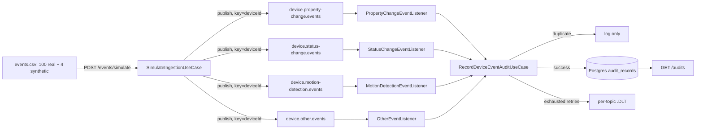

# Architecture

## Diagram

## Classification: EventCategory from msgType

The real dataset has no device-type column. Its `msgType` field (always present) is
grouped into the four kinds of event the case brief itself names: `PROPERTY_CHANGE`
(`iotProperty`), `STATUS_CHANGE` (`online`/`offline`), `MOTION_DETECTION`
(`videoMotion`/`mobileDetect`/`human`/`smartVideoMotion`), `OTHER` (everything else,
including any future unrecognized `msgType`).

## Scalability and Kafka partitioning strategy

Each category gets its own topic, partitioned by `deviceId`, 3 partitions at case
scale. At millions-of-events/day scale, partition count would grow per topic based on
observed throughput and target consumer parallelism; `PROPERTY_CHANGE` (45% of this
sample) would likely need more partitions than `OTHER` (10%).

## Consumer groups and parallelism

All four listeners share consumer group `audit-service` — one logical consuming
application across four topics. Concurrency (3, matching partition count) parallelizes
within each topic. Scaling horizontally means more `audit-service` instances, up to the
partition-count ceiling per topic.

## Ordering

Keying every record by `deviceId` guarantees one device's events land on the same
partition, consumed in order, by one consumer thread at a time. Different devices may
interleave, by design, for parallelism.

## Idempotency and duplicate handling

`eventId` is resolved once, in `device.core`: the dataset's own native id
(`body_completo.id`, present on camera/alarm-style events, or `body_completo.alarmId`
for `iotEvent`) when available, else a deterministic SHA-256 hash of
`deviceId|eventType|timestamp|payload`. `audit` checks `existsByDedupKey(eventId)`
before processing; a duplicate is logged and skipped. A database-level unique
constraint on `event_id` backs this up against race conditions.

## Retry and handling of unprocessable messages

A handler failure retries 3 times with exponential backoff (1s, 2s, 4s). If still
failing, the record is dead-lettered to `<topic>.DLT` and logged with full context —
no audit row is written. Replay from a DLT is a deliberate, manual operational action,
not automated by this application.

## Observability

Every behaviour emits exactly one structured log line (success or failure), carrying
topic/partition/offset/key context for Kafka-driven behaviours. Metrics
(`device_events_processed_total`, `device_events_duplicate_total`,
`device_events_dlq_total`, Kafka consumer lag) are scraped by Prometheus and shown in
a provisioned Grafana dashboard.

### Alerts

`observability/alerts.yml` defines five Prometheus alerting rules, loaded via
`rule_files` in `observability/prometheus.yml`, visible at
`http://localhost:9090/alerts`:

| Alert | Fires when | Why it matters |
|---|---|---|
| `DeviceEventsDeadLettered` | any event dead-lettered in the last 5m | DLT replay is manual by design — a human needs to know |
| `AuditConsumerLagHigh` | per-topic consumer lag > 100 records for 5m | `audit-service` is falling behind the producer |
| `RandomStreamPublishGap` | `random_stream_requested_total` rate exceeds `random_stream_published_total` rate for 2m | `RandomEventStreamScheduler.dispatchOne` swallows publish failures without logging them, so this gap is the only signal |
| `IotEventsAppDown` | the app's `/actuator/prometheus` scrape target is down for 1m | Prometheus itself can't reach the app |
| `DuplicateRateHigh` | duplicate rate exceeds 50% of the processed rate for 5m | upstream may be redelivering or replaying abnormally |

These rules run inside the local Prometheus container only — there is no Alertmanager
in this stack. In production, Alertmanager (or an equivalent, e.g. a managed Prometheus
service's built-in alerting) would receive these and route them to on-call, Slack, or
email with grouping/silencing; wiring that up is out of scope for a local case demo.

## Availability and fault tolerance

A single bad message never blocks a partition beyond its retry budget. The CSV adapter
tolerates malformed individual rows without aborting the batch (demonstrated by the
real dataset's 2 blank-`did` rows, resolved via a fallback rather than dropped). At
production scale, Kafka replication factor > 1 and multiple `audit-service` instances
would remove single points of failure (this case's local Kafka is a single-node KRaft
broker for simplicity).
